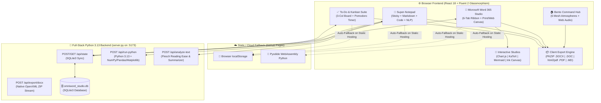

# 📝 OmniWord Studio — Enterprise Word 365 Processor, Super-Notepad & Kanban Productivity Suite

<div align="center">

[](https://raw.githack.com/drkanurag/to-do-list/main/index.html)
[](https://drkanurag.github.io/to-do-list/)
[](http://localhost:5173)
[](https://stackblitz.com/github/drkanurag/to-do-list)


**An all-in-one, full-stack document engineering and productivity platform that unifies a Microsoft Word 365 WYSIWYG Processor, a Multi-Runtime Developer & Markdown Super-Notepad, and an Interactive Kanban & Pomodoro Task Suite.**

</div>

---

## 🌐 1. Live Website & Instant Access Links

Click any link below to launch **OmniWord Studio** directly in your browser:

| Environment | Direct Website URL | Description & Capabilities |
| :--- | :--- | :--- |
| 🌍 **Public Live Website (Instant CDN)** | **[https://raw.githack.com/drkanurag/to-do-list/main/index.html](https://raw.githack.com/drkanurag/to-do-list/main/index.html)** | **Works immediately for anyone on the internet.** Zero setup required. Runs full React UI, `.DOCX`/`.PDF` exports, and in-browser **Pyodide WebAssembly Python**. |
| 🚀 **GitHub Pages Official Site** | **[https://drkanurag.github.io/to-do-list/](https://drkanurag.github.io/to-do-list/)** | **Official GitHub Pages deployment**, automatically built and published via GitHub Actions ([`.github/workflows/deploy.yml`](./.github/workflows/deploy.yml)). |
| 💻 **Local Full-Stack Server** | **[http://localhost:5173](http://localhost:5173)** | **Full-stack local server** powered by [`server.py`](./server.py) with native **Python 3.13**, **SQLite3 (`omniword_studio.db`)**, and **Matplotlib** chart rendering. |
| ⚡ **Interactive Cloud IDE** | **[https://stackblitz.com/github/drkanurag/to-do-list](https://stackblitz.com/github/drkanurag/to-do-list)** | Open, inspect, and live-edit the source code in the browser via StackBlitz. |

---

## 📦 2. Executive Project Deliverables Matrix

All core engineering deliverables have been designed, implemented, and verified:

| # | Deliverable / Module | Primary Source Files | Key Engineering Capabilities Delivered | Status |
| :-: | :--- | :--- | :--- | :-: |
| **D1** | **Microsoft Word 365 Document Processor** | [`src/App.jsx`](./src/App.jsx)<br/>[`src/components/RibbonToolbar.jsx`](./src/components/RibbonToolbar.jsx) | 6-tab Office Ribbon (*File*, *Home*, *Insert*, *Design & Layout*, *Review & Voice*, *View*), A4/Letter canvas, Portrait/Landscape, margins, multi-column layout, watermarks, headers/footers, ruler, outline navigation, Format Painter, Find & Replace. | ✅ **Completed** |
| **D2** | **Multi-Format Document Export Engine (`.DOCX` & `.PDF`)** | [`src/utils/exportUtils.js`](./src/utils/exportUtils.js)<br/>[`server.py`](./server.py) | Custom pure-JS CRC32 + PKZIP OpenXML `.docx` generator, Word 97–2003 `.doc` builder, high-DPI `html2pdf.js` `.pdf` renderer, native print-to-PDF engine, plus `.html`, `.md`, and `.txt` exporters. | ✅ **Completed** |
| **D3** | **Interactive Visual, Math, Diagram & Ink Studios** | [`src/components/InteractiveModals.jsx`](./src/components/InteractiveModals.jsx) | Live **Chart.js** data visualizer, **KaTeX** LaTeX mathematical equation builder, **Mermaid.js** flowchart/sequence diagram studio, **HTML5 Canvas** freehand drawing/signature pad, and `Ctrl+K` Interactive Feature Explorer. | ✅ **Completed** |
| **D4** | **Developer & Markdown Super-Notepad** | [`src/components/NotepadWorkspace.jsx`](./src/components/NotepadWorkspace.jsx) | 4-in-1 workspace: Color-coded Sticky Notes, Split Live GFM Markdown Preview, **Python 3.13 + Matplotlib & ES2024 JS Code Runner** (with Pyodide WebAssembly fallback), and **Python NLP Readability & Summarizer**. | ✅ **Completed** |
| **D5** | **Smart To-Do List, Kanban Board & Pomodoro Suite** | [`src/components/TodoManager.jsx`](./src/components/TodoManager.jsx) | Dual List & 3-column **Kanban Board** (*To Do*, *In Progress*, *Completed*), priorities, categories, due dates, progress bar, **25/5 Pomodoro Focus Timer**, confetti celebrations, and 1-click Word/PDF report generation. | ✅ **Completed** |
| **D6** | **Fluent 2 Bento Command Center & Animated Mesh Atmospheres** | [`src/components/BentoDashboard.jsx`](./src/components/BentoDashboard.jsx)<br/>[`src/index.css`](./src/index.css) | 12-column frosted-glass Bento Grid, SVG circular progress ring, **6 animated mesh gradient themes** (*Aurora*, *Sunset*, *Emerald*, *Cyber*, *Sakura*, *Royal*), and **Web Audio API** procedural focus soundscapes. | ✅ **Completed** |
| **D7** | **Full-Stack Python 3.13 + SQLite3 Backend & Cloud Bundler** | [`server.py`](./server.py)<br/>[`index.html`](./index.html) | Flask REST API server with automatic SQLite3 state persistence (`omniword_studio.db`), sandboxed Python + Matplotlib execution, NLP text analytics, and zero-config JSX bundling (`/app.bundle.jsx`). | ✅ **Completed** |

---

## 🏗️ 3. System Architecture



---

## 🛠️ 4. Complete Technology Stack & Open-Source Libraries Used

### Frontend & UI Engineering
| Technology / Library | Version | Purpose in OmniWord Studio |
| :--- | :--- | :--- |
| **React & ReactDOM** | `18.2.0` | Component architecture, state management, and reactive workspace switching. |
| **Custom CSS3 Design System** | Fluent 2 / Bento | Over 3,700 lines of custom styling in [`src/index.css`](./src/index.css) featuring `backdrop-filter` acrylic glass, `@keyframes floatAmbientOrb` mesh animations, and `@media print` rules. |
| **Chart.js** | `4.4.1` | Interactive Bar, Line, Pie, Doughnut, and Radar chart creation & high-res PNG embedding into Word documents. |
| **KaTeX** | `0.16.9` | Fast client-side LaTeX mathematical typesetting and equation rendering. |
| **Mermaid.js** | `10.8.0` | Declarative vector diagramming for flowcharts, sequence diagrams, and state machines. |
| **Marked.js** | `11.2.0` | Real-time GitHub-Flavored Markdown (GFM) parsing in the Super-Notepad split view. |
| **html2pdf.js (html2canvas + jsPDF)** | `0.10.1` | High-resolution client-side `.pdf` document generation with configurable page sizes and margins. |
| **canvas-confetti** | `1.9.2` | Physics-based particle celebrations on task completion and document export. |
| **FontAwesome + Google Fonts** | `6.5.1` | Office iconography and typography (*Inter*, *Playfair Display*, *JetBrains Mono*). |

### Native Browser Web APIs
| Browser API | Purpose in OmniWord Studio |
| :--- | :--- |
| **Web Audio API (`AudioContext`)** | Real-time procedural synthesis of *Gentle Rain (Pink Noise)*, *Deep Ocean (Brown Noise)*, and *14Hz Alpha Binaural Focus Drones* with zero external audio files. |
| **Web Speech API (`SpeechRecognition`)** | Live hands-free voice dictation (Speech-to-Text) directly into both the Word Processor and Super-Notepad. |
| **Speech Synthesis API (`speechSynthesis`)** | Microsoft Word "Read Aloud" Text-to-Speech document narrator. |
| **HTML5 Canvas 2D API** | Freehand digital ink drawing, highlighting, and signature capture pad. |

### Backend & Data Science Stack
| Technology / Library | Version | Purpose in OmniWord Studio |
| :--- | :--- | :--- |
| **Python** | `3.13.9` | Core server runtime powering [`server.py`](./server.py). |
| **Flask** | `3.x` | REST API routing, CORS handling, and dynamic `/app.bundle.jsx` compilation. |
| **SQLite3** | `Built-in` | Persistent relational storage (`omniword_studio.db`) for documents, tasks, notes, and settings. |
| **NumPy, Pandas & Matplotlib** | `Latest` | Scientific computing and headless (`Agg`) chart plotting inside the Super-Notepad Python runner. |
| **Pyodide (WebAssembly)** | `0.25.0` | Automatic in-browser Python execution fallback when accessed via static cloud hosting (GitHub Pages). |

---

## 🔌 5. Backend REST API Reference (`server.py`)

When running locally via `python server.py` on `http://localhost:5173`, the following REST endpoints are active:

| Method | Endpoint | Request Payload | Response / Description |
| :---: | :--- | :--- | :--- |
| `GET` | `/api/health` | *None* | Returns server status, Python version, active SQLite database name, and UTC timestamp. |
| `GET` | `/api/state` | *None* | Retrieves all persisted `documents`, `todos`, `notes`, and `pageSettings` from `omniword_studio.db`. |
| `POST` | `/api/state` | `{ documents, todos, notes, pageSettings }` | Upserts current workspace state into SQLite3 tables (`documents`, `todos`, `notes`, `settings`). |
| `POST` | `/api/run-python` | `{ "code": "import matplotlib.pyplot as plt..." }` | Executes Python 3.13 code in a sandboxed namespace with `numpy`, `pandas`, and `matplotlib`, returning `output` (stdout/stderr) and `plotPng` (base64 PNG). |
| `POST` | `/api/analyze-text` | `{ "text": "..." }` | Computes Flesch Reading Ease, Flesch-Kincaid Grade Level, Lexical Diversity, Extractive Summary, Action Items, and Top Keywords. |
| `POST` | `/api/export/docx` | `{ title, html, pageSettings }` | Generates and streams a binary OpenXML `.docx` archive with exact twips page geometry. |
| `GET` | `/app.bundle.jsx` | *None* | Dynamically combines all React modules in `src/` for zero-build browser execution. |

---

## 📂 6. Project Directory Structure

```text
to-do-list/
├── index.html                        # Application shell, CDN loaders & resilient React/Babel bootloader
├── server.py                         # Full-stack Python 3.13 (Flask + SQLite3 + Matplotlib + NLP) server
├── Start_OmniWord_Studio.bat         # 1-Click Windows launcher script (starts server & opens browser)
├── app.bundle.jsx                    # Pre-packaged unified React bundle for instant static/cloud hosting
├── omniword_studio.db                # SQLite3 relational database (auto-created on server start)
├── package.json                      # NPM metadata & Vite configuration
├── .github/
│   └── workflows/
│       └── deploy.yml                # GitHub Actions CI/CD workflow for automatic GitHub Pages deployment
└── src/
    ├── App.jsx                       # Root controller, 5 workspace modes, Word canvas & state sync
    ├── index.css                     # 3,700+ lines of Fluent 2 Glassmorphism, Ribbon, Bento & Print CSS
    ├── components/
    │   ├── BentoDashboard.jsx        # Bento Command Hub, 6 Mesh Atmospheres & Web Audio Soundscapes
    │   ├── RibbonToolbar.jsx         # 6-tab Microsoft Word 365 Ribbon Toolbar
    │   ├── NotepadWorkspace.jsx      # 4-mode Super-Notepad (Sticky, Markdown, Python/JS Code, NLP)
    │   ├── TodoManager.jsx           # Smart To-Do List, 3-Column Kanban Board & Pomodoro Timer
    │   └── InteractiveModals.jsx     # Chart.js, KaTeX, Mermaid.js, Drawing Canvas & Ctrl+K Modals
    └── utils/
        ├── exportUtils.js            # Pure-JS OpenXML (.docx), Word (.doc), PDF (.pdf), HTML, MD, TXT engines
        └── templates.js              # Professional Microsoft Word document templates gallery
```

---

## ⌨️ 7. Keyboard Shortcuts & Quick Actions

| Shortcut / Action | Function |
| :--- | :--- |
| **`Ctrl + K`** *(or `Cmd + K`)* | Open the **Interactive Feature Explorer** with 1-click **"Try It Now"** actions. |
| **`Ctrl + B` / `Ctrl + I` / `Ctrl + U`** | Apply **Bold**, **Italic**, or **Underline** in the Word document editor. |
| **`Ctrl + Z` / `Ctrl + Y`** | **Undo** / **Redo** editing actions in the Word processor. |
| **`Ctrl + P`** | Print document or save via native browser **Print-to-PDF** stylesheet. |
| **Top-Right Palette Dropdown** | Switch live between the **6 Animated Mesh Gradient Atmospheres**. |

---

## 🚀 8. Getting Started (Local & Cloud)

### Run Locally (Full Python 3.13 + SQLite3 + Matplotlib Stack)
1. **Clone the repository:**
   ```bash
   git clone https://github.com/drkanurag/to-do-list.git
   cd to-do-list
   ```
2. **Start the server (Option A — Windows 1-Click):**
   Double-click **`Start_OmniWord_Studio.bat`**.
3. **Start the server (Option B — Terminal):**
   ```bash
   python server.py
   ```
4. **Open in Browser:**
   Navigate to **[http://localhost:5173](http://localhost:5173)**.

### Run Online (Zero Installation)
- Open **[https://raw.githack.com/drkanurag/to-do-list/main/index.html](https://raw.githack.com/drkanurag/to-do-list/main/index.html)** or **[https://drkanurag.github.io/to-do-list/](https://drkanurag.github.io/to-do-list/)** from any desktop, tablet, or mobile browser.

